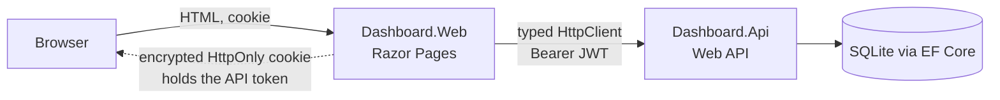

# Full-Stack Sales Dashboard (ASP.NET Core 10: Razor Pages + Web API)

A two-tier web application: an **ASP.NET Core Web API** that owns the data and security, and a **Razor Pages**
front end that signs users in, calls the API, and presents a responsive, accessible dashboard.

> All data is synthetic and generated locally. The code is original and contains nothing from any employer.

## What it shows

- **API design:** JWT auth, validation, pagination/sorting/filtering, DB-side aggregation, a business-rule state machine, RFC 7807 errors.
- **Front-end engineering without a SPA:** server-rendered pages, progressive enhancement, accessible forms, charts drawn as SVG on the server.
- **Integration:** a typed `HttpClient` that attaches the user's token, handles failures, and turns them into loading/empty/error states.

## Architecture



| Decision | Why | Trade-off |
|---|---|---|
| Razor Pages instead of a React SPA | Fast first paint, works without JS, far less client attack surface, simple auth | Less client-side interactivity; page reloads on filter/sort |
| API token stored in the encrypted auth cookie | The token never reaches page content or JavaScript (HttpOnly) | The web app is a confidential client; its cookie lifetime follows the token (no refresh tokens) |
| Charts rendered as server-side SVG | No chart library, no scripts, testable geometry, fully accessible with a data-table alternative | Not interactive (no zoom/hover beyond native tooltips) |
| Money stored as integer cents | Exact arithmetic; SUM and ORDER BY work on every database | Conversion at the API boundary |
| Aggregates computed with `GROUP BY` in the database | Constant memory regardless of order count | Needs the supporting indexes (included) |
| Controllers → services → `DbContext` | Enough structure for this size without a pointless repository layer | Would be split further if the domain grew |
| Built-in OpenAPI (.NET 10) instead of Swashbuckle | One fewer dependency; no breaking changes from third-party OpenAPI libraries | JSON document only (`/openapi/v1.json`), no bundled Swagger UI |

## Screens and states

| Page | Highlights |
|---|---|
| **Sign in** | Labelled fields, error summary, safe return-URL handling (local URLs only) |
| **Dashboard** | KPI cards, revenue-per-day column chart, status and category bars, 7/30/90-day range, chart data as a table |
| **Orders** | Search, status/category/date filters, sortable headers (`aria-sort`), pagination, "showing X–Y of Z" |
| **New order** | Accessible form: labels, hints, error summary with links, `aria-invalid`, server and API validation shown per field |
| **Order details** | Only the status changes the API allows are offered; conflicts are explained |

Every data page has an **error state** (API down/slow, with Retry), an **empty state**, and a **loading state**
(form submit shows "Searching…/Creating…" and blocks double-submits; the page also works without JavaScript).
An expired token signs the user out and returns them to login.

## Accessibility notes

Semantic landmarks and a skip link; visible focus styles; colour is never the only signal (status badges have text);
light and dark themes via `prefers-color-scheme` with checked contrast pairs; charts have `role="img"`, title,
description and a tabular alternative; forms use programmatic labels, hints and error association;
`prefers-reduced-motion` respected; responsive from phone to desktop. *Automated and manual audits (axe, screen reader
passes) have not been run yet; see Limitations.*

## Security design

- **API:** JWT (HMAC-SHA256, issuer/audience/lifetime/signature validated, algorithm pinned); every endpoint requires auth except login and `/health`; passwords hashed with ASP.NET Core Identity's `PasswordHasher`; no default credentials (the demo user comes from environment variables); the app refuses to start with a missing or weak signing key; generic 401 for unknown user vs wrong password; unexpected errors are logged server-side and returned as a generic problem response.
- **Web:** antiforgery on every POST; HttpOnly, SameSite=Lax auth cookie; CSP (`default-src 'self'`, no inline scripts or styles), `nosniff`, no-referrer; output encoding by Razor (tested with a script payload); only local return URLs are followed; query strings are validated before being forwarded; raw API/exception text is never shown to users.
- **Data:** parameterised EF Core queries; search text is LIKE-escaped; sort columns are whitelisted.

## Run locally (.NET 10 SDK)

```bash
# Terminal 1: API (Development seeds 1,500 synthetic orders)
export Jwt__Key="$(openssl rand -base64 48)"
export Bootstrap__UserEmail="demo@example.com"
export Bootstrap__UserPassword="choose-a-strong-password"
ASPNETCORE_ENVIRONMENT=Development dotnet run --project src/Dashboard.Api --urls http://localhost:5100

# Terminal 2: web app (Api:BaseUrl defaults to http://localhost:5100)
dotnet run --project src/Dashboard.Web --urls http://localhost:5200
```

Open http://localhost:5200 and sign in with the email and password you exported.
The OpenAPI document is at http://localhost:5100/openapi/v1.json (Development only).

### Docker

```bash
cp .env.example .env     # set the three values
docker compose up --build
# Web: http://localhost:8080   API: http://localhost:8081
```

## API summary

| Method | Path | Notes |
|---|---|---|
| POST | `/api/auth/login` | anonymous; returns a JWT |
| GET | `/api/dashboard/summary?days=30` | `days` 1-365; revenue = Paid + Shipped orders; zero-filled daily series |
| GET | `/api/orders` | `page`, `pageSize` (1-100), `search`, `status`, `category`, `from`, `to`, `sortBy` (orderDate, amount, customer, status, number), `desc` |
| GET | `/api/orders/categories` | known categories |
| GET / POST | `/api/orders/{id}` · `/api/orders` | create validates amount (0.01-1,000,000, 2 decimals), category, no future date |
| PUT | `/api/orders/{id}/status` | Pending→Paid/Cancelled · Paid→Shipped/Refunded · Shipped→Refunded; otherwise `409` |
| GET | `/health` | anonymous |

## Tests

```bash
dotnet test
```

- **Dashboard.Api.Tests:** auth (valid/invalid/tampered/expired tokens), summary maths with a frozen clock (date window, zero-fill, averages, status and category breakdowns, empty data), list paging/sort/filter, LIKE-wildcard safety, validation cases, exact money round-trip, the full status lifecycle, error handling without leakage.
- **Dashboard.Web.Tests:** redirects and login flows, return-URL safety, antiforgery, sign-out, expired-token handling, dashboard/list/create/details pages including **empty, error and validation states**, filter and sort link behaviour, HTML encoding, security headers, plus unit tests for chart geometry, pagination, formatting and the typed API client (bearer header, query encoding, failure mapping).

## Known limitations / future improvements

- **Not yet verified by a build:** this code was written without access to a .NET SDK. Run `dotnet test` and fix anything it reports before relying on it. Package versions use the .NET 10.0.0 baseline.
- No automated accessibility audit (axe/Lighthouse) or screen-reader pass yet.
- Single role: any signed-in user can do everything. No refresh tokens or revocation; the session ends when the token expires.
- SQLite and `EnsureCreated` for zero-setup; use migrations and a server database for production. In Docker the web app's cookie-encryption keys are not persisted, so restarting the web container signs users out.
- TLS is expected to be terminated by the host or proxy; the auth cookie is `Secure` whenever the request is HTTPS.
- No pagination caching, rate limiting or audit log.

## License

MIT
